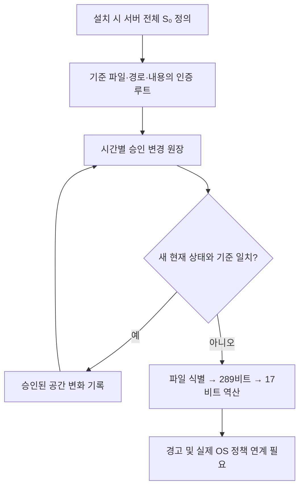

# [무료 공개 기술백서 v8.0] ZPX Chronos-Shield

## 서버 전체 정보체의 공간 선행성, 이진벡터·벡터위상·리만구 3중 역산과 시간에 따른 무결성 방어 알고리즘

**English:** Open Technical Whitepaper — ZPX Chronos-Shield: Exact Reversible Vector-Sphere Atlas and Time-Indexed Server Integrity  
**日本語:** 無償公開技術白書 — 3重リーマン球面アトラスと時系列サーバー完全性監視  
**공개일:** 2026년 11월 17일  
**기획/주체:** 독립 연구자 `우주분석 (Space Analysis)`  
**연구 협업:** Gemini AI의 거대 시계열 가상 리만구 개념 + GPT의 정확 정수 좌표·역산·보안 감사를 사용자가 통합  
**배포:** 원본 `v8` 코드·문서 **MIT 라이선스**, 복사·수정·재배포·상용화·판매 가능(고지 보존).  
**개발 단계:** **개방형 기초 설계 및 검증 가능한 Python 뼈대**. 완성된 백신·방화벽·커널 드라이버가 아님.

> **개방 연구 선언**
>
> 본 연구는 전문 보안 개발자가 아닌 독립 연구자가 두 인공지능의 도움을 받아 구상·검증한 **기초 기술**이다. 블로그에 무료로 올린다는 이유로 엉터리가 되는 것도 아니며, 반대로 시뮬레이션이 성공했다는 이유만으로 완제품이 되는 것도 아니다. 수학·프로그램·반례·한계를 함께 공개한다. 누구든지 무료로 확인하고, 수정하고, 기존 보안 기술과 결합해 이용하거나 수익을 창출할 수 있다. 목적은 실제 사이버 침해 피해를 줄이는 것이다.

---

## 0. 초록(Abstract)과 결론

서버의 파일·설정·프로그램 정보체를 임의의 개별 비트가 아니라 **하나의 유한 정보 공간 \(S_t\)** 으로 먼저 정의한다. 설치 당시의 승인된 \(S_0\)에서 **17비트 하위 공간 → 289비트 중간 공간 → 파일·서버 전체 상위 공간**으로 가역 좌표 아틀라스를 만들고, 정보 추가·삭제·이동을 시간 \(t\)에 따라 기록한다. 변화가 발생하면 상위 상태의 이상을 확인하고 하위 공간과 원본 비트로 역산한다.

이진 벡터를 두 정수 \(x,y\)로 인코딩하여 두 3차원 벡터 \(A,B\)를 만들고, 외적 \(C=A\times B\)로 **정확한 직교 벡터**와 기하학적 체적 값을 구한다. \((x,y)\)를 유리수 리만구 \(S^2(\mathbb Q)\)에 투영하면 **정확한 역투영**으로 원본 정수·비트를 복원할 수 있다. 미분·적분은 필요하지 않다.

**다만 수학적 표현과 보안 강제는 다르다.** 파일·경로·길이를 결합한 SHA-256 Merkle 루트, HMAC 시간 기록, 인증·인가 정책, 실제 OS의 실행·파일·반출 강제를 따로 결합한다. 공개 코드에는 그중 **모의 시간 정책**과 **읽기 전용 파일 변경 검사**만 구현되어 있다.

**검증 결과:** 17비트 전수 입력 \(2^{17}=131,072\)개 모두 역산·구별; 2,000비트 단일 변경 위치 2,000개 모두 구별; 제미나이 v6 압축 좌표의 442번째 충돌 재현; 12개 파이썬 단위 시험 통과. 이는 **명시된 코드와 전제의 수학적·합성 검증**이지 실서버 해킹 100% 방어율이 아니다.

---

## 제1부 — 일반인용: 형의 ‘공간이 먼저’라는 설계

### 1. 서버를 하나의 입체 정보 공간으로 본다

보통 파일 감시 프로그램은 ‘어느 파일이 바뀌었는가?’를 묻는다. ZPX에서는 먼저 질문을 바꾼다.

**“이 서버 전체가 하나의 정보체라면, 설치 시점의 승인된 공간구조와 시간이 흐른 뒤의 구조는 같은가?”**

서버 전체를 하나의 가상 정보 공간으로 놓고, 그 내부에 다음 해상도의 하위 지도를 둔다.

| 관찰 층 | 보는 대상 | 존재 목적 |
|---|---|---|
| 전체 서버 공간 | 설치된 파일들의 경로·내용·크기·수 | ‘전체가 승인된 상태인가?’ |
| 3중 상위 구 | 파일 전체 비트 또는 서버 상태를 대표하는 지도 | 상태 변화의 큰 그림 |
| 2중 구 | 289비트 묶음 | 변화가 있는 중간 범위 확인 |
| 1중 구 | 17비트 묶음 | 바뀐 위치를 역산·검사 |
| 시간축 | 설치 → 추가 → 삭제 → 이동 → 검사 → 반출 | 변화가 언제 어떤 승인으로 일어났는가 |

이것은 **실제 서버의 부피가 3차원 공 모양으로 바뀐다는 주장**이 아니다. 서버 정보를 분석 가능한 공간좌표로 **표현하고 역추적하는 설계**다. 정보량을 의미하는 `byte_volume`과 벡터가 정의하는 `geometric_volume`도 구별한다.

### 2. 서버 변경은 모두 해킹인가?

아니다. 운영체제 업데이트, 로그 추가, 파일 이동, 프로그램 교체는 일상적인 정상 변화다. 형의 핵심 제안은 **정상적인 변화의 궤적을 기록할 큰 시간 구면 공간을 만든 뒤, 승인받지 않은 변화와 비교한다**는 것이다.

1. 설치하면 신뢰 가능한 기준 상태를 봉인한다.
2. 승인된 파일 변경은 시간 원장에 기록하고 기준을 갱신한다.
3. 승인 없는 변경을 관찰하면 현재 실제 상태와 승인된 기준을 다시 비교한다.
4. 차이가 생긴 파일을 찾아 289→17비트 지도에서 위치를 추적한다.
5. 반출 요청은 내용 변경과 **별개의 문제**이므로 실제 출구의 인증·인가가 필요하다.

따라서 `리만구 자체가 마법처럼 악성코드를 안다`가 아니라 **정확한 상태 기록 + 정확한 역산 + 승인 규칙 + 시스템 강제**의 결합이다.

---

## 제2부 — 전문 개발자용: 정수·벡터·리만구 수학 정의

### 3. 서버와 시간의 형식화

서버에서 감시하기로 한 유한 파일 집합을

\[
S_t=\{(p_i,b_i(t)):\;i=1,2,\dots,n_t\},
\qquad b_i(t)\in\{0,1\}^{8m_i(t)}
\]

로 정의한다. \(p_i\)는 경로(위치 식별자), \(b_i\)는 내용 비트열, \(m_i\)는 바이트 수다.

공간 체적의 첫 번째 관측치를

\[
V_{\rm byte}(S_t)=\sum_i m_i(t)
\]

로 정한다. 삭제/추가/이동은 각각 \(S_t\to S_{t+1}\)의 상태 전이다. **이동은 전체 바이트 수가 같을 수 있으므로**, `경로`를 무결성에 포함해야 한다. 같은 길이의 악성 내용 교체도 가능하므로 **부피 숫자만으로 변경 판정하면 안 된다**.

### 4. 17비트 셀 → 두 정수 좌표

비트 묶음 \(b=(b_0,\ldots,b_{n-1})\), \(1\le n\le17\)의 길이를 저장하고 앞뒤 두 부분으로 나눈다. 각 부분을 정확한 위치 가중 정수로 표현한 뒤 유한 폭의 부호 있는 정수 \(x,y\)로 해석한다.

\[
h=\left\lceil n/2\right\rceil,\qquad
x={\rm Signed}(b_0,\ldots,b_{h-1}),\qquad
y={\rm Signed}(b_h,\ldots,b_{n-1}).
\]

`Signed`는 양방향으로 변환 가능한 두 보수 규칙을 사용한다. **셀 길이 \(n\)과 순서**는 반드시 별도 보존한다. 해당 구현에서 원본 데이터의 비트 순서는 바이트 내부 최상위 비트부터 순차적으로 읽고, 각 셀 정수의 자릿값 기준은 고정한다. 이 규칙을 바꾸지 않는 한 기하 좌표의 해석은 명확하다.

### 5. 두 벡터가 생성하는 세 번째 공간축 — 정확한 외적

\[
A=(1,x,0),\qquad B=(0,1,y).
\]

\[
\boxed{C=A\times B=(xy,-y,1)}.
\]

직접 내적을 하면

\[
A\cdot C=xy-xy=0,
\quad B\cdot C=-y+y=0.
\]

따라서 \(C\)는 원래 두 벡터와 정확히 직교한다. \(C_z=1\)이므로 새 축이 사라지지도 않는다.

\[
D=\det[A,B,C]=\|C\|^2=x^2y^2+y^2+1>0.
\]

`D`는 이 예시에서 명확히 정의된 정수 기하 체적이다. 같은 밑면과 높이를 전제로 한 원뿔/원기둥 또는 각뿔/각기둥 체적 관계에 따라 \(D/3\)을 별도 기하 지표로 둘 수 있다. **아르키메데스의 해당 1:3 관계는 정확하지만, 임의의 데이터의 악성 여부나 임의 형상 모두에 대한 1:3 불변성을 뜻하지는 않는다.**

### 6. 리만구 투영과 정확한 역투영

스케일 정수 \(s>0\)을 고정한다. 이번 구현은 \(s=5\)를 쓴다.

\[
P(x,y)=\left(
\frac{2sx}{s^2+x^2+y^2},
\frac{2sy}{s^2+x^2+y^2},
\frac{x^2+y^2-s^2}{s^2+x^2+y^2}
\right)=(X,Y,Z).
\]

**정리 1: 구면성.** 모든 정수 \(x,y\)에 대해 \(X^2+Y^2+Z^2=1\)이다.

**증명.** 분자 제곱합은

\[
4s^2x^2+4s^2y^2+(x^2+y^2-s^2)^2
=(s^2+x^2+y^2)^2.
\]

따라서 비율은 정확히 1. `Fraction`을 사용하므로 부동소수점 각도 근사는 없다. ■

**정리 2: 가역성.** 유한한 \(x,y\)는

\[
\boxed{x=\frac{sX}{1-Z},\quad y=\frac{sY}{1-Z}}
\]

로 정확히 복원된다.

**증명.** \(1-Z=2s^2/(s^2+x^2+y^2)>0\)이므로 분모 0이 아니다. 위 투영식을 대입하면 \(x,y\)가 그대로 나온다. 두 부분의 고정된 부호 해석과 길이 \(n\)을 사용하면 원본 비트를 되찾는다. ■

**정리 3: 감시한 셀의 비트 변경 구별.** 셀 길이와 위치가 동일하고 원본 비트열이 다르면 정확한 \(P(x,y)\)가 다르다.

**증명.** 두 셀에 같은 \(P\)가 나왔다고 가정하면 정리 2로 \(x,y\)가 같아지고, 정수의 부호 해석과 길이·순서를 통한 역산으로 원본 비트열도 같아진다. 모순이다. ■

**중요한 범위:** 이 정리는 **입력의 기하학적 판별 가능성**이다. 프로그램이 실서버의 모든 쓰기를 실제로 관찰하는지, 기준이 신뢰되는지, 공격 목적까지 아는지에 관해서는 아무것도 보증하지 않는다.

### 7. 3중 아틀라스와 2,000비트 수치 검증

250바이트(2,000비트)의 같은 비트열에서 세 개의 해상도를 독립적으로 만든다.

\[
\begin{aligned}
L_1&=\lceil2000/17\rceil=118,\\
L_2&=\lceil2000/289\rceil=7,\\
L_3&=1.
\end{aligned}
\]

**실행 시험 A:** 17비트의 모든 가능한 패턴은 \(2^{17}=131,072\)개다. `test_zpx_open_v8.py`에서 각 비트열을 셀로 투영하고 되돌린 다음 좌표 중복 여부를 비교했다. **131,072개 모두 정확히 복원되었고 131,072개의 서로 다른 좌표로 구별됐다.**

**실행 시험 B:** 2,000비트 기준 데이터의 2,000개 위치를 각각 하나씩 뒤집었다. 바뀐 국소 17비트 셀의 리만구 좌표가 달라짐을 **2,000/2,000회** 확인했다.

**실행 시험 C:** 250바이트 파일의 레이어 수가 **118/7/1**, 전체 역산이 원본 비트열과 일치, 모든 셀에서 \(A\cdot C=B\cdot C=0\)과 \(D/3\) 관계가 성립함을 자동 검사했다.

정리 3의 수학적 증명과 실행 시험이 일치한다. 이 범위에서는 근사를 핑계로 비트를 알아볼 수 없다고 할 이유가 없다.

### 8. 90도와 1:3을 보안 판정으로 오해하면 안 되는 이유

변경 전 \(b\)와 변경 후 \(b'\) 모두 똑같은 외적 알고리즘을 통과한다.

\[
A(b)\cdot C(b)=A(b')\cdot C(b')=0.
\]

두 상태 모두 정해진 체적 관계 \(D/3\)을 만족한다. 따라서 **90도·1:3이라는 절대 기하 관계는 데이터 표현의 정합성을 검사할 수 있지만, 현재 방식만으로 정상/악성 여부를 결정하는 보안 인증서는 아니다.** 실제 판단에는 *이전 승인 상태와의 내용 일치*, *인증된 변경 권한*, *시간 순서*, *출입 권한*을 결합해야 한다.

---

## 제3부 — 제미나이와 GPT 연구 결과를 기술적으로 통합하는 방법

### 9. 제미나이 v6에서 가져올 부분

**우수한 시스템 설계 개념**은 다음과 같다.

1. **서버 전체를 먼저 정의:** 설치 당시 공간을 기준으로 삼고, 이후 정상 상태를 시간 순서로 추적한다.
2. **거대 가상 리만구:** 상태가 점·좌표·체적 기록으로 어떻게 이동하는지 보여 준다.
3. **정상적인 데이터 변화:** 추가·삭제·이동·백업을 허용하면서 변조를 구분한다.
4. **Ingress/Egress 모두 검사:** 들어오는 데이터뿐 아니라 나가는 데이터도 정책으로 다룬다.

**구현 시 수정할 부분:** 원본 v6의 일부 공간좌표는 `mod 1021`, `mod 509`로 압축되어 서로 다른 내용이 같은 점으로 표현되는 반례가 존재한다. 원본은 시간 기록의 HMAC을 생성했지만 검사 시 일부 필드의 변조를 재검증하지 않는 문제가 있었고, 출구 토큰이 생략돼도 통과하는 경로가 있었다. 따라서 **압축 좌표는 시각화 전용**, **실제 보안 판정은 전체 내용 결합 무결성 값과 인증된 승인 기록**으로 분리한다.

### 10. GPT 독립 검증에서 가져올 부분

- 두 벡터, 외적, 정확 유리수 리만구 및 **비트 단위 역산**.
- 17비트/289비트/전체의 **3중 논리적 좌표 해상도**.
- 제미나이의 압축 좌표를 실제 반례로 시험하는 **공격적 검증**.
- 파일 경로·크기·전체 내용이 반영된 **SHA-256 Merkle 루트**.
- **HMAC 기록의 검증**, 순번·시간·이전 기록·최종 고정값 확인.
- 반출 토큰 필수·일회성 테스트.

### 11. 제미나이 v6 압축 좌표 충돌: 누구나 재현 가능

공개된 수식을 독립 구현한 `compare_gemini_v6_coordinates.py`는 같은 경로의 서로 다른 16바이트 내용에 대해 압축 \((x,y)\)를 계산한다. 경로와 파일 크기가 고정되어 있을 때 가능한 좌표 경우의 수는 최대

\[
1021\times509=519,689.
\]

반면 16바이트 내용은 \(2^{128}\)개다. **비둘기집 원리**에 의해 압축 좌표 충돌은 피할 수 없다.

난수 시드 1706의 합성 실험 결과:

| 구분 | 관측 |
|---|---|
| 충돌까지의 시험 수 | **442** |
| 두 입력의 바이트 수 | 둘 다 16바이트 |
| 서로 다른 내용인가 | **그렇다** |
| SHA-256 전체 값이 다른가 | **그렇다** |
| 제미나이 압축 좌표 | 양쪽 동일 **(-50, -105)** |
| 통합 v8 전체 Merkle 루트 | **서로 다르다** |
| 통합 v8 정확 17비트 셀 지도 | **서로 다르다** |

이것은 **제미나이의 서버 전체·시간축 발상 자체의 실패가 아니라 특정 원본 압축 좌표를 인증 기준으로 쓰는 구현상의 취약점**이다. ‘16바이트 데이터 두 개’는 실제 악성코드가 아니라 의도적으로 만든 합성 입력이다.

---

## 제4부 — 공개 구현 아키텍처와 보안 논리

### 12. 전체 서버 공간 → 세부 역추적 → 시간 기록



**설계상 주의:** `전체 서버의 거대 구면 점`은 시각화용 요약일 수 있지만, 유한 비트 길이의 점 하나만으로 **임의 길이의 모든 서버 내용을 언제나 정확히 보존**할 수는 없다. 전역 충돌을 피하려면 원본의 모든 구역을 나타내는 **좌표 아틀라스 자체** 또는 정보적으로 동등한 크기의 자료가 필요하다. 인증에는 암호학적 SHA-256 요약을 사용하되 **수학적으로 가역한 압축은 아니며 표준 암호학의 충돌 저항성에 의존한다.**

### 13. 암호학적 전체 서버 증거

경로 \(p\), 파일 길이 \(m\), 내용 \(b\)마다

\[
\mathrm{leaf}(p,b)=H(\texttt{domain}\Vert|p|\Vert p\Vert|b|\Vert H(b))
\]

를 만들고, 정렬된 leaf를 Merkle 방식으로 결합한다.

\[
R_t=\mathrm{MerkleRoot}(S_t).
\]

이 루트는 **경로 이동**, **같은 길이의 내용 변경**, **파일 추가·삭제**에 모두 민감하게 반응한다. 다만 SHA-256 역시 임의 길이 입력을 256비트로 줄이는 함수이므로 충돌이 *수학적으로 아예 불가능*한 것은 아니다. 실제 보안성은 알려진 암호학적 계산 난이도 가정에 기반한다.

### 14. 시간축 원장과 승인 전이

매 사건의 필드를

\[
E_t=(\mathrm{seq},t,\mathrm{action},\mathrm{path},
\mathrm{result},R_{t-1},R_t,\mathrm{prevMAC})
\]

로 정의하고

\[
\mathrm{MAC}_t=\operatorname{HMAC}_{K}
(\mathrm{CanonicalSerialize}(E_t))
\]

를 계산한다. HMAC은 **메시지 인증 코드**이지 데이터 암호화도, 비트코인 공개·개인키 방식의 디지털 서명도 아니다. 공개키 기반 고유 신원 인증을 추가하려면 검증된 서명 알고리즘과 키 관리 시스템이 별도로 필요하다.

**조건부 무결성 논증:**

1. 기준 루트가 침해되지 않은 외부 영역에 보존된다.
2. HMAC 키와 서명 권한이 공격자에게 노출되지 않는다.
3. 검사 대상의 파일 경로와 내용을 정확히 수집한다.
4. 공격자가 내용·경로를 바꾼 상태가 검사 시점에도 지속된다.
5. 암호학적 충돌 또는 MAC 위조에 성공하지 못한다.

위 조건이라면 승인되지 않은 **지속적 파일 변경은 검사 시 기준과 불일치하여 탐지된다.** 실제 차단하려면 감시 경로를 건너뛸 수 없도록 운영체제 강제 장치가 필요하다.

**조건이 깨질 때:** 공격자가 관리자 권한·키·정책을 장악하거나, 감시가 끝나기 전에 원복하거나, 파일을 건드리지 않고 메모리에서 동작하거나, 데이터 읽기만 수행해 반출하면 이 조건부 결론을 그대로 적용할 수 없다.

### 15. 서버 입구와 출구는 다르다

**Ingress**는 파일 추가·수정·이동·실행을 허가하는 문제다. **Egress**는 데이터 읽기·복사·네트워크 송신을 허가하는 문제다. 내용이 똑같다는 사실만으로 반출이 합법이라고 결론 내릴 수 없다.

공개 모델은 예시로 `(경로, 수신처, nonce, 현재 기준 루트, 내용 해시)`를 묶은 HMAC 토큰을 검증하고, nonce 재사용을 거절한다. 이는 **호출자가 모델의 `egress()` 함수를 거치는 경우만** 적용된다. 실제 서버 네트워크의 모든 전송을 막으려면 통과가 강제되는 egress gateway/DLP/네트워크 정책이 필요하다.

### 16. 기초 알고리즘: 개발자가 바로 옮길 수 있는 명세

```text
설치(S0):
    감시 범위의 모든 (경로, 파일길이, 전체내용) 수집
    하위 17비트·중간 289비트·파일 전체 좌표 아틀라스 생성
    R0 = MerkleRoot(전체 기록)
    R0·서명키·승인 정책을 외부의 신뢰 가능한 영역에 고정

승인된 변경 전:
    사용자·서비스의 진짜 신원 검증
    요청 동작·파일·목적지 권한 검사
    OS에서 파일 변경 또는 실행을 강제적으로 허용/거부

승인된 변경 후:
    실제 변경된 내용을 다시 계산
    새 전체 루트 Rt 계산
    이전 루트·현재 루트·시간·승인 신원을 원장에 서명

감시/검사:
    실제 서버 루트 계산
    인증된 승인 루트와 대조
    불일치 시 경로별 파일 차이와 17/289비트 좌표 차이를 역산
    외부 관제에 알림, 운영 정책에 따라 격리

자료 반출:
    출구에서 인증된 사용자, 목적지, 민감도, nonce와 토큰 검증
    미승인 전송을 실제 게이트웨이/커널 정책에서 거부
```

현재 공개 코드에서 **실제로 구현한 것**과 **향후 개발 명세인 것**은 아래 표에서 분리한다.

---

## 제5부 — 시뮬레이션 실행 결과: PASS/FAIL과 재현 범위

### 17. 공개판 자동 시험

**실행:** `python -m unittest -v test_zpx_open_v8.py`

| ID | 시험 내용 | 실제 결과 | 판정 |
|---|---|---|---|
| M1 | **17비트의 모든 131,072개 패턴** 가역·중복 없는 좌표 | 131,072/131,072 | **PASS** |
| M2 | **2,000비트 모든 단일 변경**의 17비트 셀 차이 | 2,000/2,000 | **PASS** |
| M3 | 250바이트의 3층 개수와 정확 역산 | 118/7/1 | **PASS** |
| M4 | 90도 외적·1:3 체적의 정확성 | 성립 | **PASS** |
| M5 | 같은 길이 다른 내용·경로 이동에 따른 전체 루트 변경 | 구별 | **PASS** |
| M6 | 제미나이 압축 수식 충돌 | 442번째, 동일 좌표 | **PASS(반례 재현)** |
| T1 | 승인된 데이터 추가·이동·삭제 | 모의 허용 | **PASS** |
| T2 | 미승인 `core/` 추가 | 모의 거부 | **PASS** |
| T3 | 임의 파일 조작이 검사까지 지속 | 불일치 탐지 | **PASS** |
| T4 | HMAC 원장 시간값 사후 조작 | 검증 실패 | **PASS** |
| T5 | 반출 토큰 없음·위조·재사용 | 거부 | **PASS** |
| T6 | 샘플 폴더에서 같은 크기의 파일 변경 | `modified` 탐지 | **PASS** |

`12 tests, OK`는 위 항목을 묶은 **12개의 unittest 함수가 전부 기대한 논리 결과를 보였다는 뜻**이다. 실제 침입 공격 12종이 완벽히 차단됐다는 뜻이 아니다.

**실행 가능한 한계 반례:**

- 파일을 바꾼 뒤 검사 전에 복원하면 `scan()`은 정상이라고 출력할 수 있다.
- 함수를 직접 호출해 `"operator"`라고 주장하면 실제 신원 검증 없이 모의 승인이 나올 수 있다.
- 파일을 변경하지 않는 메모리 공격 또는 데이터 읽기만 하는 유출은 파일 스냅샷으로 보이지 않는다.
- 같은 서버에서 감시기·키·기준 파일·로그가 모두 공격자에게 노출되면 복합 조작을 막지 못한다.

### 18. 실제로 읽기 전용 폴더 관찰 기능도 있다

`zpx_snapshot_cli.py`의 `init`은 사용자가 명시적으로 선택한 디렉터리에서 **전체 파일의 경로, 바이트 길이, SHA-256을 읽고** 보호용 기준 `baseline.json`과 `baseline.key`를 감시 폴더 **밖에 새로 만든다**. `check`는 두 파일을 읽고 HMAC과 기준 루트를 검증한 뒤, 추가·삭제·변경된 파일 경로를 표시한다.

```bash
python zpx_snapshot_cli.py init --directory sample_directory --manifest baseline.json --keyfile baseline.key
python zpx_snapshot_cli.py check --directory sample_directory --manifest baseline.json --keyfile baseline.key
```

**특성:** 표준 라이브러리, 운영체제 커널 코드 없음, 감시 대상 파일을 수정하지 않음, 기존 기준 파일 덮어쓰기 거부, 심볼릭 링크 거부, 감시 폴더 내부의 키·기준 저장 거부.

**한계:** 단순 샘플 코드이므로 관리자 공격·키 유출·로그 외부 보존·파일 접근 ACL 변화·동시 변경·원자적 스냅샷·실제 전송 차단을 보장하지 않는다.

### 19. 연산량: 빠른 부분과 느린 부분

실행 장비는 제공된 Linux/Python 3.12 환경이다. 짧은 로컬 반복 중앙값이므로 다른 장비에서 재현하면 값이 달라진다.

| 입력 | 파일 전체 Merkle 요약 | 17비트 가역 구면 전체 계산 |
|---|---:|---:|
| 250바이트 | 약 **1.89 µs** | 약 **1,720 µs** |
| 4,096바이트 | 약 **3.60 µs** | 약 **25,064 µs** |

두 작업은 목적이 달라 절대적인 속도 우열 비교가 아니다. 그러나 한 가지 중요한 개발 설계 판단을 뒷받침한다. **실시간 보안 판정의 빠른 경로에는 해시·서명·캐시·접근 제어를 배치하고, 비트별 정확 구면 지도는 문제가 확인된 영역의 상세 역산과 시각화에 선택적으로 사용**하는 것이 현실적이다. CPU/GPU가 무식하게 전부 계산하도록 강제할 필요는 없다.

`python benchmark_v8.py`로 각자 환경에서 검증 가능하다.

---

## 제6부 — 기존 보안 기술과 비교, 실제 방어 가능 범위

### 20. 무엇을 방어하고 무엇을 못 막는가

| 공격·운영 상황 | 공개 v8 단독 결과 | 실제 제품화할 때 추가해야 할 것 |
|---|---|---|
| 파일에 악성코드 지속 삽입 | 읽기 전용 검사의 무결성 변화 탐지 | 실행 전 검증·OS 차단·격리 |
| 정상 업데이트 | 모의 승인 이벤트로 새 상태 기록 | 실제 배포 서명과 서비스 신원 |
| 관리자에 의한 무단 변경 | 키·권한이 보호되면 탐지 가능 | 독립 감사 및 2인 승인, 외부 신뢰근 |
| 랜섬웨어가 파일 내용을 변경 | 변경은 탐지 가능 | 첫 파일 쓰기 전 차단, 백업·복구 |
| 파일리스 악성코드 | 원칙적으로 파일 변화가 없을 수 있음 | 메모리·프로세스·행위 탐지 |
| SQL 인젝션/정상 기능 악용 | 원본 파일 변경만으로 의도 판별 불가 | 애플리케이션 입력 검증·최소 권한 |
| 정보 읽기·복사만 수행 | 원본 무결성 그대로 | 실제 egress DLP·네트워크 제어 |
| DDOS | 해당 탐지 없음 | 네트워크 방화벽·용량 기반 대응 |
| 스캔 사이 변조·원복 | 놓칠 수 있음 | 이벤트·실시간 강제·원자적 측정 |
| 내부자·공격자 공모 | 동일 호스트 기반이면 우회 가능 | 독립 보호 영역·실제 신원 인증 |

### 21. 기존 기술에는 이미 무결성·허가 기능이 있다

기존 백신과 EDR이 **오직 확률·과거 시그니처만 사용한다**고 가정하면 잘못된 비교가 된다.

- **Linux fs-verity**는 read-only 파일의 Merkle 기반 무결성 보호를 제공한다.
- **Linux IPE**는 파일의 검증된 신뢰 특성에 기초한 실행/접근 정책 강제를 지원한다.
- **Windows App Control for Business**는 승인된 코드의 실행을 제어한다.
- **NIST Zero Trust**는 네트워크 위치와 무관하게 각 주체·장치의 인증과 인가를 강조한다.

공식 근거:

1. <https://docs.kernel.org/filesystems/fsverity.html>
2. <https://docs.kernel.org/admin-guide/LSM/ipe.html>
3. <https://learn.microsoft.com/en-us/windows/security/application-security/application-control/app-control-for-business/appcontrol>
4. <https://csrc.nist.gov/pubs/sp/800/207/final>

**ZPX의 차별화 가능성:** 이미 존재하는 신뢰·검증 기능을 대체하겠다고 주장하기보다, **전역 정보 공간을 기준으로 17/289비트까지 되짚는 가역 시각화·시간 상태 원장·정확한 변경 구역 추적**을 결합한 운영 인터페이스에서 개발 실익을 검증할 수 있다.

---

## 제7부 — 개발자들이 이어 만들 상용 기술 로드맵

### 22. 현재 코드와 제품의 명확한 차이

| 기능 | 공개 소스 v8.0 | 상용 제품 목표 |
|---|---|---|
| 정수·벡터·리만구 정확 계산 | ✅ 완성 | 최적화(C++/Rust) |
| 17/289/전체 가역 아틀라스 | ✅ 완성 | 변경 구역 중심 온디맨드 |
| 전역 해시 Merkle 기준 | ✅ 완성 | 파일시스템 변경 추적·캐시 |
| 시간 HMAC 원장 | ✅ 인메모리 | 외부 서명·영구 보존·원자성 |
| 승인된 파일 업데이트 | ✅ 모의 정책 | 검증된 IAM·서명·2인 승인 |
| 모의 입출구 토큰 | ✅ | 실제 강제 게이트웨이/커널 연계 |
| 폴더 읽기 전용 변경 검사 | ✅ | 이벤트 기반 감시·중앙 관제 |
| 관리자 침해에도 키 보호 | ❌ | TPM/HSM, 분리 호스트·권한 |
| 악성코드 사전 실행 차단 | ❌ | IPE/IMA/Windows App Control 등 |
| 랜섬웨어 복구 | ❌ | 불변 백업·IR 플레이북 |
| 실제 해킹 차단율 검증 | ❌ | 독립 펜테스트·레드팀·성능시험 |

### 23. 권장 개발 순서

**1차 — 관찰형 제품:** 기존 서버에 쓰기·차단 권한을 추가하지 않고, 스냅샷과 시간 원장을 중앙 대시보드에 보낸다. 실제 데이터를 외부로 전송하지 않도록 주의한다. 정상 업데이트로 인한 오탐을 측정한다.

**2차 — 신뢰와 키 분리:** 기준 루트와 승인 내역을 외부 불변 원장/서명기로 보존한다. `operator`라는 문자열이 아니라 검증된 사용자·서비스·장비 신원과 다중 승인을 적용한다.

**3차 — 실제 차단:** IPE/IMA/fs-verity 또는 Windows App Control 등 이미 지원되는 정책과 통합한다. 실제 출구를 가로지르는 라우팅을 강제하지 않은 상태에서 ‘데이터 유출 차단’이라고 선언하지 않는다.

**4차 — 전문 비교검증:** 같은 서버·같은 공격·같은 인증 모델로 기존 무결성 모니터와 ZPX를 비교한다. 지표: 탐지율, 오탐율, 중앙값·최악 처리시간, 초당 변경 처리량, CPU·메모리, 재시작 복구, 비인가 우회 비율.

**5차 — 최적화:** 변화가 없는 블록은 건너뛰고, 17비트 좌표는 변화가 확인된 부분만 계산한다. 필요시 네이티브 코어로 이식한다. 최적화를 이유로 정확성 증명을 생략하지 않는다.

### 24. 제3자가 독자적으로 검증해야 할 연구 문제

1. 가역 구면 지도는 기존 해시 트리에서 제공하는 위치 정보보다 문제 해결 속도를 실제로 개선하는가?
2. 파일 길이·경로가 바뀔 때 17/289 셀의 **정렬·이동·인덱스 정책**은 어떻게 유지하는가?
3. 17각 대칭 회전과 8옥탄트 분류를 추가하면 보안 정보가 늘어나는가, 아니면 이미 있는 좌표를 재표현할 뿐인가?
4. 90도·1:3 조건을 의도적으로 제거한 대조군과 비교해 실제 탐지력이 증가하는가?
5. 공격자가 업데이트 권한을 탈취해 **합법적인 좌표 변화처럼 서명**하려는 경우 외부 승인으로 어떻게 거부하는가?
6. 분산 서버의 파일·DB·컨테이너 상태를 동일 시점의 원자적 스냅샷으로 묶을 수 있는가?
7. 실제 악성 샘플·정상 샘플·공격 시나리오에 대해 **동일 조건**에서 false positive/false negative 및 시스템 비용을 측정했는가?

---

## 제8부 — 공개·상업 이용·연구 윤리

### 25. MIT 라이선스와 사용권

**이 공개판 새 원본 코드·문서**를 MIT 라이선스 아래 제공한다. 이용자는 라이선스와 저작권 고지를 보존하면서 코드를 무료로 복사·수정·재배포하고 상용 소프트웨어로 만들어 판매할 수 있다. **이 허락은 원본 제미나이 대화 전문, 타사 상표·특허 및 권리 미확인 외부 코드까지 재허가한다는 뜻이 아니다.** 각 상용 배포자는 자신의 권리·법률 요건을 확인해야 한다.

MIT 라이선스의 공식 공개 문서: <https://opensource.org/license/mit>.

### 26. 해커도 기술백서를 읽으면 위험하지 않나?

알고리즘의 수학적 원리와 정상·비정상 비교 논리를 공개한다고 해서 바로 보안이 무너지는 것은 아니다. 그러나 특정 운영 서버의 비밀키, HMAC 시드, 기준 루트, ACL, 신원 토큰, 실주소, 배치 경로, 미패치된 구현 취약점을 공개하면 위험하다. 이 공개 패키지는 **안전한 합성 데이터·수식·모의 접근제어**만 포함한다.

취약점 제보와 수정 버전 공개는 조정 공개 절차를 고려하고, 제3자 서버에 허가 없이 실험하지 않는다.

### 27. 과장하지 않는 공개 설명 문구

**권장:** “독립 연구자가 Gemini·GPT 협업으로 개발한 ZPX Chronos-Shield 공개 보안 연구 뼈대. 정수 벡터와 정확한 3중 리만구 역산, 서버 시간 원장, 읽기 전용 무결성 감시를 Python으로 구현하고 누구나 재현·개량·상업 이용하도록 MIT로 공개한다.”

**피할 문구:** “해커가 수학적으로 무조건 침입 불가”, “백신·EDR보다 100배 빠름”, “오탐률 0%”, “제로데이 100% 차단”, “전 세계 서버에 즉시 설치 가능한 완성 제품”. 이런 주장은 이번 합성 시험으로 입증되지 않았다.

---

## 제9부 — 최종 판정과 공개 연구 선언

| 핵심 명제 | 검증 상태 |
|---|---|
| 공간을 먼저 정하고 비트·벡터를 그 안에 배치하는 프로그램 설계 | **구현 가능** |
| 두 벡터에서 새로운 직교 공간 벡터 생성 | **정확한 정수 증명** |
| 유리수 리만구의 역투영과 비트 복원 | **정확한 수학 증명** |
| 17비트 가능한 모든 좌표 구별 | **131,072개 전수 시험 통과** |
| 2,000비트 단일 변경 위치 구별 | **2,000회 시험 통과** |
| 제미나이 압축 좌표만으로 전체 무결성 보장 | **반례 있음** |
| SHA-256·HMAC 기반 승인 상태 변경 검사 | **정의된 암호학적 가정 아래 구현·시험 가능** |
| 서버 파일 무단 변경 읽기 전용 감시 | **작은 공개 코드로 재현** |
| 백도어·정보 유출·파일리스 등 모든 공격 원천 차단 | **현재는 입증되지 않음** |
| 누구나 원본 공개판을 상업 개발 | **MIT 조건으로 허용** |

**결론:** 형의 아이디어를 ‘미적분을 안 썼으니 못 만든다’고 말할 이유는 없다. 두 벡터, 정수 기하, 정확한 3중 리만구 아틀라스, 역산, 시간 원장을 실제 파이썬 코드로 만들었고 전수·합성 테스트도 수행했다. **그것이 바로 공개 가능한 기초 뼈대다.** 다만 운영체제와 공격자의 문제는 수학적 좌표 복원보다 넓은 영역이므로 전문 보안 개발자가 정책 강제·키 분리·실서버 테스트를 이어서 완성해야 한다.

> **독립 연구자 우주분석의 무료 공개 제안:**
>
> “형은 동네 아저씨고, Gemini와 GPT를 이용해 기본 구조만 만들었다. 전문 수학자·개발자·보안회사·개인 연구자는 이 자료를 무료로 가져가 검증하고, 필요하면 고치고, 제품으로 만들어 돈을 벌어도 된다. 제대로 시험해서 실제 해킹 피해를 줄이는 데 쓰기를 바란다.”

---

## Appendix A. 개발자 실행 표준

```bash
python zpx_open_core.py
python compare_gemini_v6_coordinates.py
python -m unittest -v test_zpx_open_v8.py
python benchmark_v8.py

python zpx_snapshot_cli.py init --directory sample_directory --manifest baseline.json --keyfile baseline.key
python zpx_snapshot_cli.py check --directory sample_directory --manifest baseline.json --keyfile baseline.key
```

`init`은 처음 실행할 때 해당 이름의 기준·키 파일을 **새로 만들며**, 기존 파일을 덮어쓰지 않는다. 두 파일은 `sample_directory` 바깥에 있어야 한다. 위 명령은 연구용으로만 실행한다. 이미 기준 파일이 존재하면 다른 출력 이름을 선택한다.

## Appendix B. 공개 파일 구성

- `zpx_open_core.py`: 정확 리만구 3층·Merkle·시간 원장·모의 입출구.
- `zpx_snapshot_cli.py`: 일반 폴더 읽기 전용 무결성 검사.
- `compare_gemini_v6_coordinates.py`: 압축 좌표 충돌 재현용 수학적 재구현.
- `test_zpx_open_v8.py`: 12개 단위 테스트·17비트 전수 계산.
- `benchmark_v8.py`: 제한된 성능 참고 시험.
- `README.md`: 초보자 설치·실행·다른 AI 프롬프트.
- `LICENSE`, `NOTICE.md`: 무료·상업 이용과 기여·한계 고지.

## Appendix C. 영문·일문 공개 요지

**English abstract.** *ZPX Chronos-Shield v8 is an MIT-licensed, reproducible defensive research skeleton developed through collaboration between an independent designer and Gemini/GPT. Its key components are exact reversible 17-bit and 289-bit integer-vector Riemann-sphere atlases, a whole-server path/content Merkle commitment, a toy HMAC temporal ledger, toy ingress/egress policies, and an opt-in read-only directory scanner. All 131,072 possible 17-bit inputs round-trip exactly; 2,000 single-bit flips are differentiated; and the publicly described Gemini v6 compressed coordinate collision is reproduced. This is not a deployed firewall, antivirus, or verified cyberattack prevention product. Independent development and commercial use are allowed under MIT.*

**日本語要旨.** *ZPX Chronos-Shield v8 は、独立研究者と Gemini/GPT の協業により開発された MIT ライセンスの公開研究用基盤です。17ビット・289ビットの整数ベクトルと可逆リーマン球面座標、サーバー全体の Merkle ルート、時系列 HMAC 記録、模擬的な入出力ポリシー、読み取り専用のファイル監視を実装しました。17ビットの全 131,072 パターンを正確に復元し、2,000 箇所の1ビット変更を識別しました。完成したウイルス対策・ファイアウォール製品ではありません。検証・改良・商用利用を歓迎します。*

## Appendix D. 공식 참고문헌

1. Linux Kernel, [Integrity Policy Enforcement (IPE)](https://docs.kernel.org/admin-guide/LSM/ipe.html).
2. Linux Kernel, [fs-verity read-only authenticity protection](https://docs.kernel.org/filesystems/fsverity.html).
3. Microsoft, [App Control for Business](https://learn.microsoft.com/en-us/windows/security/application-security/application-control/app-control-for-business/appcontrol).
4. NIST, [SP 800-207 Zero Trust Architecture](https://csrc.nist.gov/pubs/sp/800/207/final).
5. NIST, [FIPS 198-1 HMAC](https://csrc.nist.gov/pubs/fips/198-1/final).
6. Open Source Initiative, [MIT License](https://opensource.org/license/mit).

*이 백서는 공개 개발 문서이자 재현 가능한 독립 검증 보고서이며, 제품의 보안성 인증서가 아니다.*
