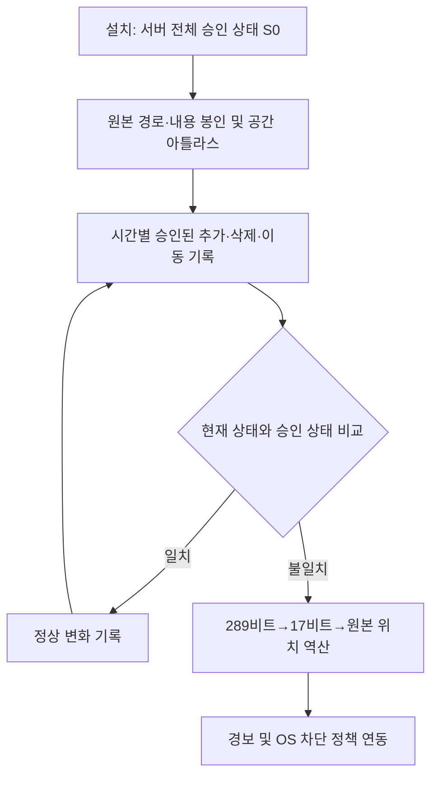

# [전면 공개 통합 기술백서 v9.0] ZPX Chronos-Shield

## 서버 전체 정보 공간의 정수 벡터·리만구 역산, 시간축 무결성 방어와 공개 지식재산권 보존 선언

**English title:** *ZPX Chronos-Shield — Open Research Whitepaper on Exact Reversible Sphere Atlases, Time-Indexed Server Integrity, and Rights-Preserving Publication*  
**日本語題名:** *ZPX Chronos-Shield — 可逆リーマン球面座標・時系列サーバー完全性・権利を維持する公開技術白書*  
**문서 버전:** 9.0 / 2026년 11월 17일  
**기초 구상 및 독립 연구 주체:** 우주분석 (Space Analysis)  
**연구 지원 도구:** Google Gemini AI, OpenAI GPT  
**개발 단계:** 공개 연구 아키텍처·수학적 증명·합성 시뮬레이션·Python 개념검증(PoC). 실서버에 인증된 완성 백신이 아님.  
**재현 코드:** `ZPX_Chronos_Shield_Public_MIT_v8_2026-11-17.zip`의 Python 3.10+ 공개 소스와 12개 단위 시험.  
**이 문서의 이용 조건:** 원 저작권이 인정되는 부분에 대한 출처표시형 자유 공개 권고안 **CC BY 4.0**. 기존 v8 소프트웨어 및 부속 문서에는 해당 배포본의 **MIT 라이선스**가 유지된다. 저작권·특허·상표·제3자 자료의 권리는 서로 별개이며 라이선스가 없는 권리를 임의로 허여하지 않는다. 최종 대외 배포자는 보유 권리와 출원 계획을 확인해야 한다.

> **개방·권리 보존 선언.** 이 연구는 전문 보안 개발자가 아닌 독립 연구자가 Gemini·GPT를 연구 도구로 사용하여 제안하고 교차검증한 **기본 뼈대**다. 누구든지 이 기술의 공개 부분을 검증하고, 개선하고, 후속 제품을 만들어 수익을 창출할 수 있기를 바란다. **무료 공개는 정당한 저작권·발명자 지위·상표·연구 기록을 포기한다는 선언이 아니다.** 다만 오픈 라이선스로 허용한 사용은 그 라이선스 범위 안에서 존중한다. 본 프로젝트는 해킹과 데이터 유출의 피해를 줄이는 공개 협력에 목적이 있다.

---

## 요약: 먼저 결론 여섯 가지

1. **서버 전체를 하나의 정보 공간으로 정의하는 설계는 기술적으로 구현 가능하다.** 설치 상태를 봉인하고 시간별 파일 추가·삭제·이동·변경을 기록하며 입구와 출구에서 검증한다.
2. **유한한 비트 셀을 정수 벡터와 리만구 좌표로 정확히 왕복 변환할 수 있다.** 17비트의 모든 `131,072`가지 입력과 2,000개의 단일 비트 변경 사례를 검증했다. 미분·적분은 필요 없다.
3. **공간좌표의 가역성과 악성코드 여부는 다르다.** 정상 데이터와 악성 데이터 모두 정확히 좌표화된다. 보안 판단은 승인된 이전 상태, 경로·내용 무결성, 권한·인증, 시간 기록, 실제 OS 차단 기구와 결합해야 한다.
4. **Gemini의 시간축 공간 모델과 GPT의 역산·반례 검증을 결합했다.** 일부 압축 좌표는 충돌하므로 보안 인증에 쓰지 않으며, SHA-256 Merkle 루트와 HMAC 이력으로 보완했다.
5. **무료로 전면 공개하면서도 권리를 포기하지 않을 수 있다.** MIT·CC BY 등 라이선스는 저작권자의 권리를 소멸시키기보다 지정된 이용을 허용하는 약속이다. 반면 추후 같은 공개 버전에 대한 사용료를 일방적으로 청구할 수 있는 것은 아니다.
6. **정확한 공개는 대기업의 동일 기술 독점 특허를 견제하는 선행기술이 될 수 있다.** 그러나 공개 내용의 범위, 출판일, 특허 심사, 국가별 법률에 좌우된다. 대기업의 개량 발명 특허를 완전히 봉쇄하거나 형의 독점 특허권을 자동으로 만들어 주는 것은 아니다.

---

# 제1부. 일반인·비전공자용: 형의 구상은 무엇인가?

## 1. 서버를 작은 파일들의 모음이 아니라 시간에 따라 변하는 하나의 공간으로 본다

설치 시점의 서버 전체 상태 `S0`를 승인된 정보체로 정의한다. 그 안의 파일 경로, 파일 내용, 바이트 수, 설정, 실행 코드의 감시 가능 부분을 하나의 **논리적 공간**으로 본다. 그 공간을 조사하는 정수·벡터·구면 좌표는 17비트 국소 영역부터 289비트 중간 영역, 파일 전체 및 서버 전체 순으로 계층화한다.

예를 들어 오전에 1,000개 파일이 있던 서버에서 오후에 로그 파일 하나가 늘어나는 것은 정상일 수도 있다. 반면 같은 크기의 실행 파일 한 비트가 몰래 바뀌었다면 바이트 총량은 그대로여도 감시해야 한다. 따라서 **단순한 총 부피 숫자**만 아니라 원본 내용, 위치, 시간, 승인 이력을 함께 기록한다.

‘리만구 속 서버’는 물리적인 공에 전자들을 넣는다는 뜻이 아니다. 정보의 여러 계층을 기하학적으로 표현해 **전체 변화 확인 → 의심 영역 축소 → 원래 비트·파일로 역추적**할 수 있도록 만드는 개념이다.



## 2. ‘아르키메데스 3분의 1’과 ‘90도’는 어디에 쓰는가?

형의 구상에서 핵심은 개별 비트를 보기 전에 **공간과 체적 관계를 먼저 정의하는 것**이다. 두 벡터에서 정확한 직교축을 만들고 세 벡터의 체적 지표를 계산할 수 있다. 같은 밑면·높이의 각기둥과 각뿔의 체적이 `3:1`이 되는 고전 기하 관계도 **선택한 입체 구성에서** 정확히 적용된다.

다만 정상 파일도, 악성 파일도 이 계산을 통과하므로 `90도 = 안전`, `1/3 = 무해`라는 자동 판정은 성립하지 않는다. 보안에서 결정적 조건은 **좌표가 어제의 인증된 좌표와 맞는가, 그 변화가 정당하게 승인되었는가**다.

## 3. 개발자가 얻게 되는 것

- 변경 전후의 서버 상태를 **하나의 시간축 기록**으로 추적하는 설계도.
- 17비트·289비트 단위의 **정확한 비트 복원 도구**.
- 경로 변경이나 같은 길이 파일 교체에도 반응하는 **암호학적 무결성 비교**.
- 정상 업데이트와 무단 변경을 분리해 모델링하는 **승인 정책 골격**.
- **입구(쓰기·배포)와 출구(읽기·반출)**를 별개 경계로 관리하는 아이디어.

대기업이든 개인 개발자든 여기에 운영체제 강제 정책, 고성능 데이터베이스, 관리 화면 등을 붙여 실제 제품을 만들 수 있다.

---

# 제2부. 전문가용: 정수 벡터와 리만구의 정확한 정의 및 증명

## 4. 서버 상태의 수학적 정의

감시하기로 지정한 서버 파일 집합을

\[
S_t=\{(p_i,b_i(t))\}_{i=1}^{n_t},\qquad b_i(t)\in\{0,1\}^{8m_i(t)}
\]

로 놓는다. `p_i`는 정규화한 경로 식별자, `b_i(t)`는 파일 내용, `m_i(t)`는 바이트 길이다. 총 정보량은 `V_byte(S_t)=Σ_i m_i(t)`이고, 이는 **벡터 외적에서 얻는 기하 체적**과 다른 지표다. 두 종류의 ‘체적’을 구분하지 않으면 내용이 바뀌었는데도 전체 파일 크기가 같아지는 경우를 놓친다.

## 5. 17비트 정수 셀의 가역 인코딩

길이 `1≤n≤17`의 비트셀 `b=(b0,…,b(n-1))`을 길이 `h=ceil(n/2)`의 앞부분과 나머지 부분으로 분할한다. 두 부분을 고정된 비트 순서의 유한 폭 정수 `(x,y)`로 **일대일 인코딩**한다. 각 부분의 길이와 셀의 순서를 같이 보관해야 역산이 가능하다.

이 방법은 큰 파일을 17비트씩 나누어 각각 정확한 좌표를 할당한다. 289비트(`17×17`)도 같은 방식으로 중간 그룹을 구성한다. 이론적으로 모든 셀의 정보가 보존되는 반면 **좌표 아틀라스 전체는 데이터량에 따라 커진다.** 전체 서버가 유일한 3차원 점 하나로 손실 없이 무한 압축되는 것은 아니다.

## 6. 두 벡터에서 세 번째 직교축 도출

\[
A=(1,x,0),\quad B=(0,1,y),\quad C=A\times B=(xy,-y,1).
\]

두 내적은

\[
A\cdot C=xy-xy=0,\qquad B\cdot C=-y+y=0.
\]

따라서 `C`는 `A`와 `B`에 정확히 직교한다. 별도의 미적분 근사는 사용하지 않는다. 또한

\[
D=\det[A,B,C]=\|C\|^2=x^2y^2+y^2+1>0.
\]

이 **정의된 평행육면체의 부피 지표**에 대해 같은 밑면·높이의 각뿔을 놓으면 대응 체적은 `D/3`이다. 이는 정확한 구성적 관계이지 **어떤 서버 데이터든 항상 1:2:3 비율로 변해야 한다**는 주장은 아니다. 체적비를 관측하려면 어떤 세 입체를 비교하는지부터 지정해야 한다.

## 7. 정확한 리만구 좌표와 역함수

고정된 양의 정수 `s=5`와 위의 `(x,y)`에 대해

\[
P(x,y)=(X,Y,Z)=\left(
\frac{2sx}{s^2+x^2+y^2},
\frac{2sy}{s^2+x^2+y^2},
\frac{x^2+y^2-s^2}{s^2+x^2+y^2}
\right).
\]

**정리 A — 구면성.** 항상 `X²+Y²+Z²=1`이다. **증명:** 분자 제곱합을 전개하면 분모 제곱 `(s²+x²+y²)²`과 정확히 같다.

**정리 B — 가역성.** 모든 유한한 `(x,y)`에 대해 `1−Z>0`이고

\[
\boxed{x=\frac{sX}{1-Z},\qquad y=\frac{sY}{1-Z}}
\]

로 정확한 정수를 복원한다. 고정된 셀 길이·순서로 두 정수를 비트로 복원할 수 있다.

**정리 C — 단일 비트 차이 구별.** 고정 길이·순서의 동일 셀에서 한 비트가 다르면 `(x,y)`가 다르고, 정리 B에 따라 `P`도 다르다. 따라서 **감시한 해당 셀의 가역 좌표는 서로 다르게 나타난다.**

**한계:** 여기서 증명한 것은 *수학적 입력 구별*이지 *실제 서버가 모든 쓰기를 반드시 관측한다*, *악의적 의도를 구별한다*, *파일 암호화 전에 반드시 차단한다*는 성질이 아니다.

## 8. 원래의 17-대칭 압축 요약과 정확 지도는 용도가 다르다

제미나이가 제안한 17-대칭 위상 요약은 패턴 탐색·시각화에 유용할 수 있다. 하지만 하나의 작은 위상 벡터로 긴 임의 비트열 전체를 압축할 때는 충돌 가능성을 따져야 한다.

기존 v6 관련 독립 재현에서는 좌표 후보가 `1021×509=519,689`개인 압축 `(x,y)`를 사용했다. 서로 다른 16바이트 입력 후보는 `2^128`개이므로 **일대일 대응이 불가능하다.** 난수 시드 `1706`의 합성 시험에서 442번째 샘플에 좌표 `(-50,-105)`가 중복되는 사례가 관측되었다.

이는 **시간별 전체 서버를 공간으로 본다는 아이디어의 부정이 아니라, 인증에 압축 좌표만 사용하면 안 된다는 검증 결과**다. 압축 위상 요약은 관찰·시각화용으로, 보안의 승인 여부는 원본 내용과 신뢰된 암호학적 근거로 결정한다.

---

# 제3부. 시스템 보안 설계와 실제 구현 범위

## 9. 전체 서버의 내용·경로를 암호학적으로 봉인한다

파일의 정규화된 경로 `p`, 크기 `m`, 전체 내용 `b`를 길이 구분 가능한 형식으로 직렬화해

\[
L(p,b)=H(\mathrm{tag}\Vert|p|\Vert p\Vert|b|\Vert H(b))
\]

로 만들고 정렬된 리프를 Merkle 트리로 결합해 `R_t=MerkleRoot(S_t)`를 얻는다. `H`는 SHA-256 등 검증된 암호학적 해시 함수를 쓴다. **리만구와 달리 해시는 가역적이지 않으며, 충돌이 수학적으로 불가능하다고 주장하지 않는다.** 실제 방어는 표준 암호학의 계산적 보안성과 안전한 키·기준 관리에 의존한다.

파일 크기는 같아도 내용이 바뀌면 리프가 달라진다. 이름만 바꾼 이동도 경로가 달라졌으므로 구별된다. 실제 파일 시스템에서는 권한, 소유자, 링크, 특수 파일, 컨테이너, 데이터베이스 트랜잭션 등 수집 범위를 별도 규격으로 정해야 한다.

## 10. 시간축 원장

이벤트 `E_t`는 시퀀스 번호, 신뢰된 시간, 조작 유형, 변경 전후 루트, 승인 주체, 이전 원장 인증값 등을 결합한다.

\[
M_t=\operatorname{HMAC}_{K}\bigl(\operatorname{Canonical}(E_t)\bigr).
\]

`HMAC`은 기록의 인증 코드이며 **암호화나 개인키·공개키 디지털 서명과 같은 뜻이 아니다.** 기준 루트와 인증 키를 감시 대상 서버와 같은 관리자 권한 아래 두면 침입자가 둘 다 수정할 수 있다. 배포 시에는 서버 외부의 신뢰 저장소, 별도 승인권자, 변경 불가능하거나 외부로 전송되는 원장 등이 필요하다.

## 11. 출입구를 별도로 다룬다

- **Ingress:** 누가 어떤 경로에 무엇을 설치·수정·실행하려 하는가. 코드 서명·승인 정책이 필요하다.
- **Egress:** 누가 어떤 내용을 어느 수신처로 복사·송신하는가. 내용이 변경되지 않은 **단순 유출**은 파일 무결성만으로 탐지할 수 없다.
- **모의 토큰:** 경로·수신처·nonce·현재 승인 루트·내용 요약을 결합해 인증하며 재사용을 거절한다. 그러나 모든 통신이 이 토큰 검사를 거치도록 하는 실제 방화벽·게이트웨이·DLP 구현은 v8에 없다.

## 12. 시스템 알고리즘 — 개발자가 구현할 규칙

```text
INSTALL(trusted_server_state):
    scope := explicit_allowlist_of_monitored_objects
    S0 := collect_consistent_path_and_content_snapshot(scope)
    R0 := authenticated_merkle_root(S0)
    store_R0_and_approval_keys_off_host()
    build_exact_sphere_atlas_on_selected_segments(S0)

ON_CHANGE(event, new_state):
    if not authenticated_identity_or_not_authorized_transition(event):
        alert_and_request_OS_enforcement()  # v8에서는 실제 강제 미구현
        return
    if not validate_event_chain(event):
        alert(); return
    Rnew := merkle_root(new_state)
    append_authenticated_event(event, Rold, Rnew)
    display_time_indexed_spatial_delta()

VERIFY():
    current := collect_consistent_scope_snapshot()
    if merkle_root(current) != last_approved_root:
        changed_objects := compare_manifest_by_path_and_content()
        for object in changed_objects:
            exact_reverse_map_289_to_17_bit_cells(object)
        alert_without_claiming_certain_malware_identity()

EGRESS(request):
    require_authenticated_identity_and_nonreusable_token()
    require_real_gateway_to_enforce_all_relevant_paths()
```

## 13. 실서버에 필요한 미완성 구성요소

| 요소 | 현재 v8 공개판 | 상용화를 위해 필요한 것 |
|---|---|---|
| 정수·벡터·리만구 가역 지도 | 구현 및 수학 검증 | 변경 영역 선택 계산·시각화 최적화 |
| 파일·경로 Merkle 루트 | 구현 | 대규모 증분 갱신·신뢰된 동시 스냅샷 |
| 시계열 HMAC 원장 | 모의 구현 | 외부 로그·키 보호·인증된 시간·복구 |
| 폴더 변경 검사 | 읽기 전용 CLI | 이벤트 누락·TOCTOU·심볼릭 링크 대책 |
| 입출구 검증 | 모의 정책 | 실제 커널·게이트웨이 강제·신원 증명 |
| 백신/EDR 기능 | 미구현 | 행위·메모리·프로세스 탐지·대응 |
| 실전 해킹 방어율 | 미측정 | 독립 공격 시험·오탐·성능 벤치마크 |

현실적인 경로는 Linux의 `fs-verity`, IPE/IMA 같은 무결성 정책과 Windows App Control처럼 이미 존재하는 **강제 실행 제어**에 연구 코어를 연동하는 것이다. 기존 EDR·방화벽·권한 관리·격리 백업을 없애는 것이 1차 목표가 아니다.

---

# 제4부. 수학적·기술적 시뮬레이션의 재현 결과

## 14. 검증값과 한계 구분

| 검증 항목 | 결과 | 입증 범위 |
|---|---:|---|
| 모든 17비트 패턴 | **131,072/131,072** 복원 | 고정 폭 정수→구면→원본 비트 왕복 정확성 |
| 250바이트(2,000비트) 입력 | **118 / 7 / 1** | 17/289/2,000비트 3중 셀 수 |
| 2,000비트에서 한 자리씩 변경 | **2,000/2,000** 구별 | 변경 위치가 감시 셀에 들어왔을 때의 좌표 차이 |
| 두 벡터와 외적 | **정확 직교** | `A·C=B·C=0`, 정의한 체적의 정수 관계 |
| Gemini v6 압축 좌표 | **442번째 샘플에서 충돌 관측** | 좌표만으로 인증할 때의 반례 |
| 코드 단위 시험 | **12개 통과** | 공개 v8의 합성 환경에서 명세대로 동작 |
| 실서버 랜섬웨어 예방률 | **자료 없음** | 미검증 |
| 기존 EDR 대비 속도·오탐 우위 | **자료 없음** | 미검증 |

테스트를 재현하려면 공개 ZIP을 받아 Python 3.10 이상 환경에서 실행한다.

```bash
python zpx_open_core.py
python compare_gemini_v6_coordinates.py
python -m unittest -v test_zpx_open_v8.py
python benchmark_v8.py
```

별도 예제 폴더를 읽기 전용으로 검사할 때만 다음 명령을 사용한다. `init`은 기준 파일과 키 파일을 **새로 생성**하므로 실제 서버에 무심코 실행하지 말아야 한다.

```bash
python zpx_snapshot_cli.py init --directory sample_directory --manifest baseline.json --keyfile baseline.key
python zpx_snapshot_cli.py check --directory sample_directory --manifest baseline.json --keyfile baseline.key
```

이 테스트는 공격자의 실제 악성코드를 분류한 시험이 아니라 **가역 변환과 모의 무결성 검사의 재현**이다. 따라서 **‘해킹 100% 차단’, ‘오탐 0%’, ‘제로데이 무조건 차단’**이라는 문구를 이 증거로 주장해서는 안 된다. 해킹 방어 연구가 빈약하다는 뜻이 아니라 **증명한 대상과 아직 시험하지 않은 대상을 정밀하게 구분한 것**이다.

## 15. 기존 기술과의 장단점

| 비교 | 공개 ZPX 연구의 잠재적 장점 | 현실적 한계 |
|---|---|---|
| 기존 파일 무결성 감시(FIM) | 전체 상태·시간·구면 지도를 하나의 진단 뷰로 연결 가능 | 기존 FIM 역시 경로·해시 변조 검출 가능; 우위 실증 필요 |
| 해시/Merkle | 해시가 알려 주지 못하는 원본 **비트 위치**를 가역 지도에서 재구성 가능 | 원본 비트가 보존돼 있어야 하며 구면 계산이 추가 비용 발생 |
| EDR/XDR | 승인된 파일·설정 변경에 대한 구조적 증거 보강 가능 | 파일리스·계정 탈취·권한 남용·메모리 공격은 별도 방어 |
| 방화벽·DLP | 전체 서버 상태·시간 이력과 반출 정책을 연계하는 설계 가능 | 실제 전송 경로를 강제하지 않으면 복사·유출을 못 막음 |
| 대규모 서버 | 증분 Merkle와 선택적 국소 역산으로 최적화 여지 | 수백만 파일·실시간 DB·고가용성 성능 시험 없음 |

**성능 주장에는 제거 실험이 필요하다.** 동일 장비·동일 입력에서 `(A) 해시/정책만`, `(B) 해시/정책+가역 리만구 진단`을 비교해 진단 시간·CPU·메모리·오탐·개발자의 사고 파악 속도를 수치로 제시해야 한다. 추가 효과가 없다면 그 구성요소를 단순화해도 된다.

---

# 제5부. 공개하되 권리를 포기하지 않는 법적·기술적 전략

## 16. ‘공개’와 ‘권리 포기’의 차이

**저작권의 권리 귀속**과 **타인에게 주는 이용 허락**은 서로 다르다. 기술백서가 무료라는 사실만으로 적법하게 보호되는 저작물의 권리를 포기하는 것은 아니다. MIT는 저작권 고지를 유지하면서 복사·수정·재배포·판매를 허용한다. CC BY 4.0은 출처표시를 요구하면서 복제·각색·상업적 활용을 허용한다.

하지만 여기에는 다음 네 가지 구별이 필요하다.

1. **표현의 저작권:** 인간의 창작성이 인정되는 구체적 글·도식·코드 표현. 추상적 수학 원리·아이디어 자체와 다르다.
2. **특허를 받을 수 있는 권리/특허권:** 구체적 기술적 발명이 요건을 만족하고 적법하게 출원·등록될 때의 별도 권리. `©` 표시나 백서 저자 표시만으로 자동 발생하지 않는다.
3. **상표:** `ZPX`, `ZPX Chronos-Shield` 등 이름과 공식성의 관리. 등록·선사용 등 법률 요건을 별도 검토한다. 일반 코드 라이선스가 타인의 공식 제품 사칭을 허락하는 것은 아니다.
4. **비밀정보:** 공개된 정확한 내용은 더 이상 비밀로 유지하기 어렵다. *영업비밀을 보존하면서 모든 세부를 완전 공개할 수는 없다.*

또한 Gemini·GPT가 자동 생성한 문장·코드 전체의 저작권이 사용자에게 무조건 성립한다고 보장할 수는 없다. 실제 인간 기여와 편집·설계의 창작성이 중요하다. **연구의 최초 제안서, 수정 지시, 수학적 논점과 오류 교정, 버전 기록, 개발 일자**를 보존해야 한다.

## 17. ‘대기업이 가져가 특허 내면 개인은 못 쓰게 된다’는 걱정의 정확한 분석

### 17.1 먼저 공개한 기술은 후발 동일 특허의 선행기술이 될 수 있다

날짜와 내용이 확인되는 백서·코드·도면·실험을 누구나 접근할 수 있도록 공개하면, **그 공개된 기술 내용은 이후 특허출원에 대한 선행기술(prior art)**로 활용될 수 있다. 이것이 **방어적 공개(defensive publication)** 전략이다. 따라서 제3자가 *동일한 기존 공개 내용을 새로 발명한 것처럼* 독점 특허를 취득하는 일을 견제할 수 있다.

다만 다음은 자동으로 보장되지 않는다.

- 누군가 출원서를 제출하는 것 자체를 기술적으로 막는 장치는 아니다.
- 심사관이 해당 백서를 반드시 발견한다는 보장도 없다. 분쟁에서는 공개 일자와 내용 입증이 중요하다.
- 단순한 제목·홍보 문구로는 충분하지 않을 수 있으므로 **구체적 수식·데이터 구조·방법·검증 코드**를 명료하게 공개해야 한다.
- 후발 기업이 **공개되지 않은 별도의 신규 개선 기술**을 만들면, 개선 부분에 대한 특허 가능성은 남는다.
- 타인이 이미 가지고 있던 **선행 특허**를 형의 후발 공개가 무효화하는 것은 아니다.

### 17.2 공개는 형 자신의 특허 기회에도 영향을 준다

한국 특허법에는 특정 요건을 갖춘 자기 공개에 대한 **12개월 공지예외** 제도가 있지만, 각국 기준은 다르다. 특히 유럽·중국 등 해외 출원에는 별도 위험이 있으므로 **특허가 필요한 구체적 발명은 공개 전에 출원 검토**가 가장 안전하다. 이미 일부 내용을 블로그에 올렸다면 최초 공개일부터 조사해야 한다.

### 17.3 ‘전 세계 누구나 계속 사용’이 목표라면

기본 아키텍처를 상세히 공개하고 적절히 라이선스하면 공동체가 활용할 수 있다. 하지만 **오픈소스 코드의 라이선스와 특허 라이선스는 다른 층위**이므로 보호를 더 강하게 설계하려는 미래 기여 프로젝트는 *명시적인 특허 허여 조항이 있는 오픈소스 라이선스*도 검토할 수 있다. 예를 들어 **Apache License 2.0**에는 기여자가 허여하는 특정 특허권의 범위와 관련 특허소송 시 허가 종료 조건이 명시되어 있다. 이 규정도 모든 제3자 특허 문제를 해결하는 것은 아니다. 반대로 이미 MIT로 배포한 v8의 허가를 나중에 일방적으로 철회한다고 가정해서는 안 된다.

## 18. 권장 공개 라이선스 구조

| 자료 | 권장 공개 조건 | 개발자의 권한 | 형에게 남는 것과 제한 |
|---|---|---|---|
| v9 백서 신규 텍스트·도식 중 권리 보유 부분 | **CC BY 4.0 제안** | 출처표시 후 복사·수정·번역·상업 활용 | 창작자의 출처·표시 유지, 사용료 청구는 기본 조건 아님 |
| 기존 v8 Python 코드와 부속 문서 | **배포본 MIT 유지** | 복제·개선·판매 가능, 고지 보존 | 저작권이 인정되는 부분의 권리·고지 유지, 강제 로열티 없음 |
| 원래의 추상적 수학 아이디어 | 라이선스로만 독점할 수 없음 | 권리와 법률에 따라 독립 구현 가능 | 특허 신규성·구체적 청구항은 별도 문제 |
| ZPX 이름·공식 로고 | 별도 상표/브랜드 정책 검토 | 연구 명칭을 사실대로 인용 가능 | 공식 제품 사칭과 출처 혼동 문제 대응 가능 |
| 미공개 Gemini 대화 원문·제3자 코드 | 이 문서의 공개 허가 범위 밖 | 권리자 허가·각 서비스 조건 확인 | 형이 소유하지 않은 부분을 재허가할 수 없음 |

여기서 **권리를 모두 포기한다는 `CC0`, ‘퍼블릭 도메인 헌정’, ‘무조건 무권리 선언’은 선택하지 않는다.** 동시에 MIT/CC BY를 적용한 뒤에 **‘전면 사용 금지, 상업 사용 불가’**라는 상충하는 문구를 붙이지 않는다.

**권장 권리표시 예문**

> © 2026 우주분석 (Space Analysis). Human research/design contributions and protectable expressions: rights retained. This whitepaper is made available for public study and reuse under CC BY 4.0 to the extent the publisher has rights to license its contents. The separate ZPX Chronos-Shield v8 software package remains under its included MIT License. Neither public disclosure nor this notice constitutes a waiver of any independently existing patent, trademark, or other legal right. No exclusive ownership is asserted over abstract mathematics, generic ideas, or third-party material. Gemini and GPT were AI research tools, not independent legal co-authors.

이 표시만으로 법적인 독점 특허권이 만들어지는 것은 아니다. **권리의 존재는 실제 창작성·발명 기여·등록·선행기술 등에 좌우된다.** 본문은 법률 조언 대신 공개 전략의 일반적인 검토를 제공한다.

## 19. 기업이 제품을 만들어 큰돈을 벌면 형에게 돈을 줘야 하나?

**MIT 소프트웨어와 CC BY 백서만 사용한 기업은 통상 형에게 수익을 나눌 계약상 의무가 없다.** 그 대신 원 출처와 각 라이선스의 고지를 지켜야 한다. 이 부분은 ‘돈을 벌어도 알아서 하라’는 형의 공개 취지와 잘 맞는다.

그러나 **법적인 의무가 없다는 것과 감사 표시를 할 수 없다는 것은 다르다.** 개발자나 기업은 자발적으로 연구비를 후원하거나, 오류 수정에 기여하거나, 공동연구를 제안하거나, 별도 계약으로 자문료·라이선스료를 지급할 수 있다. 기대할 수 있는 가능성은 있지만 후원 금액이나 실제 발생 여부를 예측할 수는 없다.

형이 원한다면 공개 페이지에 다음 문구를 추가하는 것이 현실적이다.

> **자율 후원 안내.** 본 보안 연구의 공개 코드 사용과 상업적 활용에는 의무적 후원금이나 매출 배분 조건이 없습니다. 연구가 도움이 되어 자발적으로 개발비 지원·협력·감사의 뜻을 전하고 싶은 개인과 기업의 연락을 환영합니다. 후원 여부와 관계없이 공개 라이선스에 따른 권리는 동일합니다. 형도 컴퓨터 사고 실험과 커피를 계속하려면 연구비가 필요합니다. 🙂

기부 계좌·이메일·주소는 사용자 의사에 따라 별도로 추가한다. 실제 후원금을 받을 때는 국내 세무·사업 운영 문제를 확인해야 한다.

## 20. 출판 증거를 남기는 실무 절차

1. **저자·연구 제안자 명시:** `우주분석(Space Analysis)`과 AI 연구 지원 도구를 구분한다. 인간 공동 기여자가 있을 때는 실제 기여에 따라 정확히 표시한다.
2. **원본 출처 보관:** 최초 설계 문장, Gemini·GPT 입력과 수정 지시, 계산 및 코드 버전, 테스트 기록을 변경 불가능한 복사본으로 보관한다.
3. **버전·발행일 고정:** v8/v9 해시, 파일명, 공개 URL, 공개 시각을 보관하고 이후 수정은 새 버전으로 발행한다.
4. **검색 가능한 상세 문서 공개:** 기술 범위·구성·명세·수식·시험을 읽기 쉬운 텍스트로 남기고 재현 가능한 ZIP을 함께 제공한다.
5. **표준 라이선스 그대로 첨부:** MIT `LICENSE`와 v9 `CC BY 4.0` 링크, 저작권 고지를 혼동 없이 명시한다.
6. **민감한 운영 정보 제외:** 실제 서버 키·계정·운영 경로·네트워크 구성·개인정보는 공개하지 않는다.
7. **특허 전략 확인:** 국내외 특허를 원할 가능성이 있다면, 새롭게 공개할 구체적 구현 전에 전문가와 검토한다. 이미 공개한 기술은 날짜를 역추적한다.

---

# 제6부. 개발자에게 보내는 공개 협력 요청

## 21. 자유롭게 검증·개선·상용화하되, 다음 기준을 지켜 달라

**공개 개발에 참여하는 모든 사람에게 요청한다.**

- 논리 오류나 반례가 발견되면 숨기지 말고 **재현 입력과 패치**를 함께 공개해 달라.
- '정확한 구면 좌표'와 '실제 공격 차단'을 혼동하지 말고 **동일 조건의 독립 실험**으로 평가해 달라.
- 현재 공개 코드가 못 막는 파일리스 공격, 관리자 사칭, 정상 기능 악용, 데이터 복사, 도중 원복, DDoS 등을 명시해 달라.
- 실제로는 Linux/Windows 커널 기능과 결합한 뒤 **비프로덕션 환경에서만** 차단 시험을 시작해 달라.
- 공개 코드와 백서를 가져다 제품을 만들고 돈을 벌어도 좋다. 다만 라이선스를 지키고 원 연구 출처를 표시해 달라.
- 가능하다면 원 연구자의 다음 단계 검증을 도와 달라. 공개 연구를 지원하는 데 비용이 들 수 있다는 사실도 이해해 달라.

## 22. 다음 독립 검증 연구 과제

1. 17·289비트 가역 아틀라스를 실제 변경 영역에만 계산하는 방식과 기존 Merkle-only 방식을 비교.
2. 기준 상태의 변조 가능성, 키 탈취, 관리자 권한 탈취에 대한 분리된 신뢰 근원 시험.
3. 정상 업데이트·대규모 로그·DB 변경에서 **오탐과 시스템 부하** 측정.
4. 재부팅/롤백/스냅샷 복원/클러스터 이동 중 일관된 기록 유지 실험.
5. 파일변경이 없는 공격과 승인된 프로그램 오용을 대상으로 한 탐지 공백 측정.
6. 수십만 파일 서버에서 **CPU·메모리·검증 지연·운영 비용** 공개 벤치마크.
7. 공간 변화 지도 시각화가 실제 보안 분석가의 **원인 파악 속도**를 높이는지 비교 실험.
8. 대외 배포의 권리 범위, 후속 기여자 라이선스, 특허 허여와 상표 사용 정책을 공동체 표준으로 정리.

---

# 제7부. 최종 검증 판정 및 공표문

## 23. 어떤 주장까지 가능한가?

| 주장 | 현재 판정 | 이유 |
|---|---|---|
| 서버 전체를 시간에 따라 변하는 정보 공간으로 모델링 | **가능** | 유한 파일집합·이벤트·상태 정의 가능 |
| 정수 벡터→리만구→원본 비트의 정확 역산 | **조건부 수학적 증명** | 셀 길이·순서·정확 유리수 계산 보존 시 |
| 정의된 외적에서 90도 직교 | **증명** | 내적이 정확히 0 |
| 비교할 각뿔 체적이 같은 각기둥의 1/3 | **해당 기하 구성에서 참** | 임의 데이터의 악성 판정과 무관 |
| 하나의 유한 구면점에 임의 서버 정보를 전부 손실 없이 압축 | **성립하지 않음** | 유한 요약 정보량의 한계 |
| 비인가 지속 파일 변경의 비교 탐지 | **모형에서 가능** | 신뢰된 기준·완전 수집·검사 시점·해시 가정 필요 |
| 모든 악성코드/내부자/제로데이 원천 차단 | **미입증** | 실서버 OS 강제·공격 시험 없음 |
| 무료 공개와 권리 보존의 병행 | **가능** | 저작권 귀속과 이용 허락 구분 |
| 공개 백서가 후발 동일 특허를 견제 | **가능성 높음, 조건부** | 선행기술의 공개 범위·시점·법률 심사에 좌우 |
| 다른 개발자가 형에게 돈을 주어야 함 | **의무 아님** | 자유로운 상업 이용과 자발적 후원은 별개 |

## 24. 공개 연구 선언 — 그대로 인용할 수 있는 문안

> 나는 전문 보안 기업이나 대학 연구소에 소속된 개발자가 아니라, 정보 공간을 정수·벡터·리만구로 보고 역산하는 구조를 제안해 온 독립 연구자 ‘우주분석’이다. Gemini와 GPT라는 두 인공지능 도구를 이용해 기초 설계를 수학·코드·반례로 점검하였다. 내가 공개하는 것은 완성된 절대 보안 제품이 아니라, 다른 개발자가 실제 서버에서 이어서 검증하고 발전시킬 수 있는 기본적인 뼈대다.
>
> 이 설계를 공개하는 이유는 세계 곳곳의 해킹과 랜섬웨어 피해를 줄이는 기술을 누구나 함께 만들기를 바라기 때문이다. 대학·개인 개발자·기업은 해당 공개 라이선스를 지키며 무료로 연구하고 제품을 개발하고 상업적으로 판매해도 좋다. 이 공개는 법적으로 인정되는 원 연구자의 창작·발명 기여와 지식재산권을 스스로 포기한다는 뜻이 아니다.
>
> 이 백서의 수학적 검증 결과와 한계는 모두 공개한다. 누구든지 반론·반례·개선을 제시할 수 있다. 아직 검증되지 않은 방어 효과를 완성된 사실처럼 말하지는 않는다. 가능하다면 이후 성공한 개발자들이 다른 연구자들과 이 기초 연구도 자발적으로 지원해 주기를 바란다. 기술은 공개하고, 공로는 정확히 남기며, 성과는 사회에 돌아가기를 바란다.

---

## 부록 A. 한국어·영어·일본어 권리 요약

**한국어:** 이 백서와 공개 코드는 이용자의 자유로운 연구·개량·상업 활용을 목적으로 제공한다. 무료 공개는 저작권의 자동 포기나 특허권의 자동 취득을 의미하지 않는다. 기존 v8 코드·문서의 MIT 조건을 존중하며, v9 신규 백서는 권리자가 허여할 수 있는 부분에 한하여 CC BY 4.0 공개를 권고한다. 특허를 고려한다면 공개 전에 상담하는 것이 안전하다. 자발적 후원은 환영하지만 필수는 아니다.

**English:** *This whitepaper presents an openly reproducible research skeleton, not a certified anti-malware product. Public access does not automatically waive copyright or create patent rights. The v8 code and accompanying materials retain their MIT terms; CC BY 4.0 is proposed for the licensable, new v9 whitepaper expression. Readers may independently evaluate and commercialize permitted implementations while preserving required notices. Defensive publication may create prior art against later claims to the disclosed subject matter, but it does not preclude patents on genuinely new improvements, nor preserve all future international patent options for the discloser. Voluntary sponsorship is welcome and not required.*

**日本語:** *本白書は、完成したウイルス対策製品ではなく、再現可能な公開研究の基礎設計を提示するものです。無償公開は著作権の放棄や特許権の自動取得を意味しません。既存のv8コード・付属文書にはMITライセンスが適用され、v9白書の新たな権利保有部分にはCC BY 4.0による公開を提案します。公開資料は後願の同一技術に対する先行技術となり得ますが、新規の改良発明すべてを排除するものではありません。任意の研究支援は歓迎しますが義務ではありません。*

## 부록 B. 소스 및 공개 기술 문서

### 기존 연구·코드

- `WHITEPAPER_KR.md` — ZPX Chronos-Shield v8 수학·보안 통합 공개백서.
- `zpx_open_core.py` — 정확한 17/289비트 리만구 지도, Merkle 루트, 시간 원장, 모의 정책.
- `compare_gemini_v6_coordinates.py` — Gemini 압축 구면의 충돌 반례를 독립적으로 재구현.
- `zpx_snapshot_cli.py` — 읽기 전용 폴더 무결성 확인.
- `test_zpx_open_v8.py` — 17비트 전수·2,000비트 단일 변경 등 12개 자동 시험.
- `benchmark_v8.py`, `README.md`, `LICENSE`, `NOTICE.md`.

### 1차 지식재산권 근거

1. WIPO, *Inventing the Future — Intellectual Property for Business*, defensive publication: <https://www.wipo.int/edocs/pubdocs/en/wipo_pub_917_1.pdf>.
2. WIPO, *Frequently Asked Questions: Patents*, prior art and grace periods: <https://www.wipo.int/en/web/patents/faq_patents>.
3. 대한민국 지식재산처, *공지예외주장 제도* — 특허법 제30조 및 요건: <https://www.kipo.go.kr/ko/kpoContentView.do?menuCd=SCD0200239>.
4. 대한민국 지식재산처, 해외 출원 시 공지예외 위험 안내: <https://www.kipo.go.kr/ko/kpoBultnDetail.do?aprchId=BUT0000029&menuCd=SCD0200618&ntatcSeq=19514&sysCd=SCD02>.
5. Open Source Initiative, *MIT License*: <https://opensource.org/license/mit>.
6. Creative Commons, *Attribution 4.0 International*: <https://creativecommons.org/licenses/by/4.0/>.
7. 한국저작권위원회, *Guide to Copyright Registration for Generative AI-Assisted Works*: <https://www.copyright.or.kr/eng/doc/etc_pdf/Guide_to_Copyright_Registration_for_Generative_AI-Assisted_Works.pdf>.
8. Apache Software Foundation, *Apache License, Version 2.0* (명시적 특허 허여): <https://www.apache.org/licenses/LICENSE-2.0>.

### 1차 보안 기술 근거

9. Linux kernel, *Integrity Policy Enforcement (IPE)*: <https://docs.kernel.org/admin-guide/LSM/ipe.html>.
10. Linux kernel, *fs-verity*: <https://docs.kernel.org/filesystems/fsverity.html>.
11. Microsoft, *App Control for Business*: <https://learn.microsoft.com/en-us/windows/security/application-security/application-control/app-control-for-business/appcontrol>.
12. NIST, *Zero Trust Architecture*, SP 800-207: <https://csrc.nist.gov/pubs/sp/800/207/final>.

---

**종합 결론:** 형이 제안한 **서버 전체 공간을 먼저 정의하고 시간에 따른 공간 변화로부터 세부 비트와 파일을 역산한다**는 출발점은 공개 연구의 중심에 그대로 둔다. Gemini의 전체·시간축 개념과 GPT의 정확한 셀 역산·충돌 반례·암호학적 감사 체계를 결합하여 재현 가능한 기본 코드로 제공한다. 누구든지 이를 기반으로 후속 방어 기술을 자유롭게 개발할 수 있다. **기술을 공개한다는 이유로 정당한 출처와 권리를 포기하지 않는다.** 동시에 공개 코드의 이용허락과 아직 증명되지 않은 보안성, 특허 출원 가능성을 정확히 구분한다.
